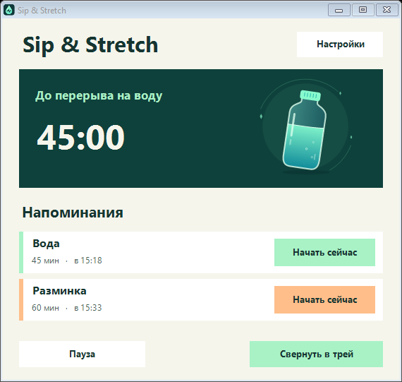

# Sip & Stretch

Портативные напоминания для Windows о воде и короткой разминке. Во время перерыва появляется анимированная бутылка с водой или персонаж, который показывает приседание.

[Скачать Sip & Stretch 1.0.0 для Windows](https://github.com/chearttemche-sys/SipStretch/raw/refs/heads/main/downloads/SipStretch-1.0.0-Portable.zip)



## Запуск

Запустите **SipStretch.exe** из любой папки, доступной для записи. Если скачали ZIP, сначала распакуйте его. Для работы нужен Windows 10 или 11 с .NET Framework 4.8. Приложение работает без сети и прав администратора.

- Первое напоминание о воде появится через 45 минут после запуска, о разминке — через 60 минут. В настройках можно выбрать для каждого интервал от 1 до 480 минут или выключить его.
- «Начать сейчас» открывает перерыв сразу. «Готово» начинает новый интервал для выбранного напоминания. «Через 5 мин» откладывает его. Крестик автоматического напоминания тоже откладывает его на пять минут.
- Если оба перерыва совпали, сначала появится вода, затем разминка. Приложение показывает по одной карточке.
- Кнопка «Пауза» приостанавливает оба таймера. «Продолжить» запускает полные интервалы заново. Сохранение настроек и перезапуск приложения также начинают новый отсчёт.
- Крестик основного окна и «Свернуть в трей» оставляют таймеры работать. Дважды щёлкните по капле в области уведомлений, чтобы открыть окно. Для полного завершения выберите «Выход» в меню значка.

Настройки записываются в **SipStretch.ini** рядом с программой после нажатия «Сохранить». Чтобы перенести их, скопируйте этот файл вместе с EXE.

## Сборка из исходников

На Windows с .NET Framework 4.8 откройте PowerShell в корне проекта и выполните:

```powershell
.\build.ps1
```

Готовая программа появится в `dist\SipStretch.exe`. Иконка в формате ICO находится в `app\SipStretch.ico` и встроена в EXE. Графика рисуется средствами GDI+, интерфейс использует Windows Forms.
